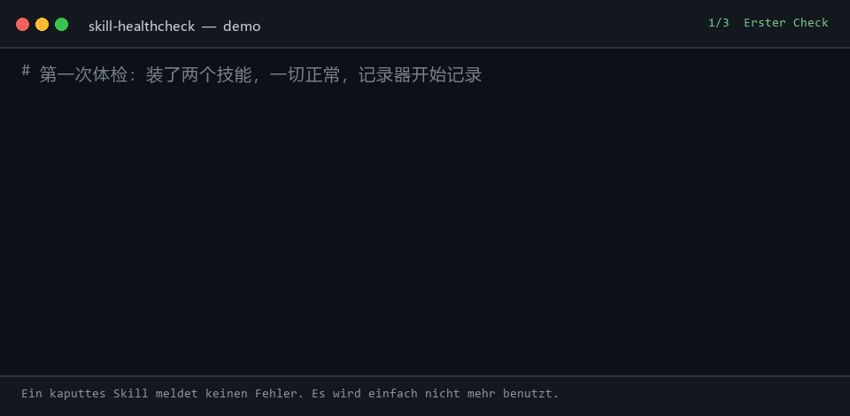

# skill-healthcheck

[English](README.md) | [中文](README.zh.md) | [日本語](README.ja.md) | [한국어](README.ko.md) | [Español](README.es.md) | [Français](README.fr.md) | Deutsch | [Português](README.pt-BR.md)

<p align="center">
  <a href="https://github.com/lijiaqimun-coder/skill-healthcheck/actions/workflows/ci.yml"></a>
  
  
  
  
</p>

<p align="center">
  
</p>

<p align="center">
  
</p>

> Dein Agent ist in letzter Zeit dümmer geworden? Vielleicht liegt es an dem Skill, das du vor drei Wochen installiert hast.

Wenn ein Plugin kaputtgeht, merkst du es sofort: es lässt sich nicht installieren, es wirft Fehler, es verschwindet aus der Oberfläche. **Wenn ein Skill kaputtgeht, merkst du es nie**: `SKILL.md` liegt weiter auf der Platte, alles sieht normal aus, und das Modell benutzt es einfach nicht mehr. Vielleicht hat der Upstream die `description` geändert, das Skill umbenannt, das Repository gelöscht — oder ein lokales Skill mit demselben Namen verdeckt es. Du bemerkst nur, dass „der Agent nicht mehr zuhört“ oder „nicht mehr auf Chinesisch antwortet“, und gibst dann dem Modell und deinen Prompts die Schuld.

`skill-healthcheck` beantwortet genau eine Frage:

**Funktioniert noch, was ich installiert habe? Was ist kaputt, und seit wann?**

Ein Befehl, ein Check, ein Bildschirm Ausgabe. Nur lesend, und es aktualisiert sich nie von selbst.

```text
$ skill-healthcheck
skill-healthcheck · DeepSeek Harness · profile desktop · 2026-10-23 11:57
宿主  dsh 0.2.1-rc.2 ✓
插件  0：0 正常 · 0 可升级 · 0 失效  另有组合包 1 个
技能  2：1 正常 · 1 有更新 · 0 失效
      ↑ zh-writer        上游改了 description：删去 "中文" "写作" "助手"，新增 "professional" "assistant" "marketing"  ⚠最高危
结论：技能 1 个需你逐个确认

$ skill-healthcheck why "为什么它现在不用中文回答我了"
why "为什么它现在不用中文回答我了" → 回复语言变了
现象起点：助手回复的中文占比：2026-10-19 之前约 100%，当天 0%（你仍在用中文提问）
1. doc-writer           2026-10-19 起模型看到的 description 变了
     新增"professional tone"
     新增"Always respond in English"
     删去 "需求" "整理" "结构" "清晰"
这是按时间和关键词排的嫌疑顺序，不是定论；可以先停用第 1 名验证。
```

(Die Ausgabe des Tools ist derzeit auf Chinesisch; eine englische Ausgabe steht auf der Roadmap.)

(Die Ausgabe oben stammt aus einem echten `npm run demo`-Lauf: beide Skills kommen aus lokalen Git-Repositories, das Sitzungsprotokoll ist synthetisch.)

## Installation

Erfordert Node.js 22.19+ und git.

```bash
npm install -g skill-healthcheck
```

Falls es noch nicht auf npm ist, aus dem Quellcode installieren:

```bash
git clone <this repo> && cd skill-healthcheck && npm install && npm run build && npm link
```

## Verwendung

| Befehl                                    | Zweck                                                                                                                    |
| ----------------------------------------- | ------------------------------------------------------------------------------------------------------------------------ |
| `skill-healthcheck`                       | Check auf einem Bildschirm: Host, Plugins, Skills                                                                        |
| `skill-healthcheck why "<Symptom>"`       | Geht die Zeitachse zurück zu verdächtigen Skills, z. B. `why "不用中文回答了"`; akzeptiert auch `--since 2026-10-01`     |
| `skill-healthcheck log`                   | Journal darüber, was installiert wurde, was sich geändert hat und wann (`~` markiert aus Dateizeiten geschätzte Angaben) |
| `skill-healthcheck ls`                    | Welche Skills die Plattform tatsächlich lädt, welche verdeckt und welche verworfen werden                                |
| `skill-healthcheck adopt <name> <Quelle>` | Quelle eines Skills registrieren: `github:owner/repo/path`, eine GitHub-URL oder `<git-url>#<path>`                      |
| `skill-healthcheck record`                | Einen einzelnen Schnappschuss aufnehmen (für Hooks und geplante Jobs)                                                    |

Häufige Optionen: `--all` alles aufklappen, `--json` maschinenlesbar, `--offline` ohne Netzwerk, `--no-sessions` Sitzungsprotokolle ignorieren, `--platform dsh|generic`, `--profile <Name>`, `--cwd <Projektverzeichnis>`.

`check` endet mit Exit-Code 1, wenn es Probleme findet, und passt damit in die CI.

## Was geprüft wird

**Skills: lokal (offline, deterministisch)**

| Problem                                                                                            | Warum es still fehlschlägt                                                                                            |
| -------------------------------------------------------------------------------------------------- | --------------------------------------------------------------------------------------------------------------------- |
| Ungültiges Frontmatter (name nicht kebab-case, Boolescher Wert falsch geschrieben, alter Feldname) | dsh verwirft das ganze Skill und schreibt nur eine Warnzeile ins Log                                                  |
| Von einem gleichnamigen Skill verdeckt                                                             | Ein gleichnamiges Skill unter dem projektweiten `.dsh/skills` verdeckt das global installierte                        |
| Zu tief verschachtelt                                                                              | Nur `<root>/<name>/SKILL.md` wird erkannt; ein komplett geklontes Skill-Repository aktiviert dort kein einziges Skill |
| Falsches Verzeichnis                                                                               | dsh durchsucht weder `~/.claude/skills` noch `~/.codex/skills`                                                        |
| description über 500 Zeichen                                                                       | Sie wird im Katalog abgeschnitten, sodass das Modell die Triggerwörter am Ende nie sieht                              |
| Früher oft genutzt, dann eines Tages nie wieder                                                    | Die Belege aus dem Sitzungsprotokoll sind stärker als jede Vermutung                                                  |

**Skills: Upstream (git, jede Hosting-Plattform)**

| Upstream-Änderung                               | Auswirkung                                                                                                                                                                                           |
| ----------------------------------------------- | ---------------------------------------------------------------------------------------------------------------------------------------------------------------------------------------------------- |
| `description` geändert                          | ⚠ Höchstes Risiko: Die Auslösebedingungen haben sich geändert und das Skill wird vielleicht nie wieder aufgerufen. Es listet die entfernten und hinzugefügten Wörter und markiert Sprach-/Ton-Regeln |
| `name` geändert / Verzeichnis verschoben        | Der Einstieg `/alter-name` funktioniert nicht mehr; du bekommst den neuen genannt                                                                                                                    |
| Repository gelöscht / Skill gelöscht            | Deine lokale Kopie ist nicht mehr gepflegt (nur ein eindeutiges 404 gilt als Löschung; Netzwerkfehler melden „konnte nicht prüfen“)                                                                  |
| Neue ausführbare Datei in `scripts/`            | Ein Mensch muss den Code prüfen                                                                                                                                                                      |
| description länger geworden oder über dem Limit | Sie wird abgeschnitten oder kostet in jedem Turn mehr Kontext                                                                                                                                        |
| Body länger geworden                            | Wie viele zusätzliche Tokens jeder Aufruf kostet (der Body wird bei Bedarf geladen und verdrängt daher keine anderen Skills)                                                                         |
| Neue plattformspezifische Syntax                | PowerShell-Cmdlets, `brew`, `/usr/bin` zum Beispiel — läuft auf deinem System vielleicht nicht                                                                                                       |

**Plugins (dsh)**: ob die in einem Profile installierten Plugins mit der aktuellen dsh-Version kompatibel sind (`engines.dsh` / peerDependencies), ob sie über eine Versionsausnahme laufen, ob npm eine neuere Version hat und ob der Autor sie als veraltet markiert hat.

**Die Zusammenfassungszeile ist absichtlich asymmetrisch**: `插件 2 个可一键升级；技能 3 个需你逐个确认` („2 Plugins lassen sich auf einmal aktualisieren; 3 Skills musst du einzeln prüfen“). Plugins sind npm-Pakete mit Versionsnummer und Rollback; Skills sind Prompts — einmal überschrieben, ist die alte Version weg, und wenn sich das Verhalten geändert hat, merkst du es nicht. Deshalb muss ein Mensch draufschauen.

## Zuordnung: `why`

Das Tool protokolliert ab dem allerersten Lauf (`~/.skill-healthcheck/journal.jsonl`): was installiert, was geändert, was gelöscht wurde, mit dem vollständigen Text jeder Version jedes `SKILL.md`. `why` kombiniert dieses Journal mit den Sitzungsprotokollen von dsh (die den Skill-Katalog enthalten, den das Modell jeweils gesehen hat, in zeitlicher Reihenfolge) und sortiert die Verdächtigen:

- **Symptom-Lexikon**: ordnet „antwortet nicht mehr auf Chinesisch“ Sprachregeln zu (`respond in English`, `professional tone`, `默认使用英文`, …)
- **Zeit**: Änderungen näher am Symptombeginn sind verdächtiger; spätere Änderungen werden abgewertet
- **Verhaltensumschlag**: berechnet aus den Sitzungsprotokollen den Anteil chinesischer Antworten und die Aufrufzahlen, um den Tag des Wandels zu finden

Alles ist deterministischer Code ohne LLM-Aufrufe, die Ergebnisse sind stabil und testbar.

## Mit echten Daten validiert

Wir haben 74 echte `SKILL.md`-Änderungen aus 15 öffentlichen Skill-Repositories gesammelt (anthropics/skills, obra/superpowers, vercel-labs/agent-skills, deepseek-ai/deepseek-harness und andere) und die Regeln auf jede einzelne angewendet:

| Änderungsart           | Erkannt / tatsächlich |
| ---------------------- | --------------------: |
| description geändert   |               44 / 44 |
| name geändert          |               18 / 18 |
| Verzeichnis verschoben |               20 / 20 |
| Skripte hinzugefügt    |               13 / 13 |

In diesem Datensatz haben 37 Upstream-Änderungen Wörter aus der description entfernt, 16 das Skill umbenannt und 3 eine neue Version erzeugt, die dsh direkt verwirft. Datensatz, Reproduktionsschritte und Regelabstimmung stehen in [research/EVAL.md](research/EVAL.md).

## Daten und Privatsphäre

- Liest nur deine Skill-Verzeichnisse, dsh-Profile und Sitzungsprotokolle; schreibt nichts außerhalb von `~/.skill-healthcheck/`.
- Sitzungsprotokolle werden nur lokal gelesen, und nur abgeleitete Daten werden zwischengespeichert (Skill-Katalog, Aufrufzahlen, täglicher Anteil chinesischer Antworten). Gesprächstexte werden nie gespeichert.
- Upstream-Prüfungen laufen in separaten Bare-Repositories unter `~/.skill-healthcheck/cache/`; es wird nie in deine eigenen Skill-Repositories gefetcht oder dort etwas verändert.
- Netzwerkzugriff passiert genau drei Dinge: `git fetch` der Skill-Upstreams, die GitHub-API fragen, ob ein Repository noch existiert, und `npm view` für Plugin-Versionen. `--offline` schaltet alles ab.

## Plattformunterstützung

| Plattform                                         | Umfang                                                                                                                      |
| ------------------------------------------------- | --------------------------------------------------------------------------------------------------------------------------- |
| DeepSeek Harness (dsh)                            | Vollständig: bildet Scan-Reihenfolge und Parsing-Regeln von dsh nach, füllt Sitzungsprotokolle nach, prüft Plugins und Host |
| Generische Agent Skills (Claude Code, Codex usw.) | Durchsucht `.agents/skills`, `.claude/skills`, `~/.codex/skills` und führt lokale sowie Upstream-Prüfungen aus              |

Bei erkanntem `~/.dsh/profiles` schaltet es automatisch in den dsh-Modus; mit `--platform` lässt sich das auch erzwingen.

## Wie die Quelle eines Skills bestimmt wird

dsh selbst hält nicht fest, woher ein Skill installiert wurde, deshalb probiert das Tool diese Reihenfolge und sagt sonst „Quelle unbekannt“, statt zu raten:

1. Eine mit `skill-healthcheck adopt` registrierte Quelle
2. `metadata.source` im Frontmatter
3. Das Skill-Verzeichnis ist ein Git-Checkout → dessen `origin` verwenden

## Entwicklung

```bash
npm install
npm test        # vitest: parsing, discovery, journal, impact rules, upstream (local bare repos), attribution, lexicon
npm run demo    # 15-second demo, runs entirely inside demo/.sandbox
node scripts/corpus-eval.mjs   # run the impact rules over 74 real changes (build first; fetches files from GitHub)
```

## Roadmap

- [x] Journal, lokale Prüfung stiller Fehlschläge, Nachfüllen der Sitzungsprotokolle
- [x] Upstream-Verfügbarkeit und Bewertung der Änderungsauswirkungen
- [x] `why`-Zuordnung (Minimalversion)
- [x] Plugin-Kompatibilität und Update-Prüfung (dsh)
- [ ] dsh-Plugin-Shell `dsh-skill-healthcheck`: beim Host-Start protokollieren, Skill-Änderungen beobachten, `/skill-healthcheck` bereitstellen
- [ ] Optionales `--explain`: den Diff per LLM in einen Satz übersetzen (standardmäßig aus)
- [ ] Englische Ausgabe (`--lang en`)

## License

MIT
