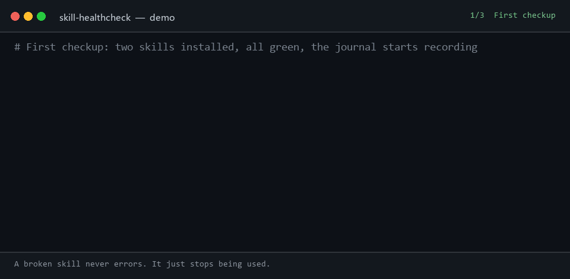

# skill-healthcheck

[English](README.md) | [中文](README.zh.md) | [日本語](README.ja.md) | [한국어](README.ko.md) | [Español](README.es.md) | Français | [Deutsch](README.de.md) | [Português](README.pt-BR.md)

<p align="center">
  <a href="https://github.com/lijiaqimun-coder/skill-healthcheck/actions/workflows/ci.yml"></a>
  
  
  
  
</p>

<p align="center">
  
</p>

<p align="center">
  
</p>

> Votre agent est devenu plus bête récemment ? C'est peut-être ce skill installé il y a trois semaines.

Quand un plugin casse, vous le savez tout de suite : il ne s'installe pas, il plante, il disparaît de l'interface. **Quand un skill casse, vous ne le savez jamais** : `SKILL.md` est toujours sur le disque, tout semble normal, et le modèle cesse simplement de s'en servir. L'upstream a peut-être modifié la `description`, renommé le skill, supprimé le dépôt — ou un skill local du même nom le masque. Tout ce que vous remarquez, c'est que « l'agent n'écoute plus » ou qu'« il ne répond plus en chinois », et vous finissez par blâmer le modèle et vos prompts.

`skill-healthcheck` répond à une seule question :

**Ce que j'ai installé fonctionne-t-il encore ? Qu'est-ce qui a cassé, et depuis quand ?**

Une commande, un bilan, un écran de sortie. En lecture seule, et il ne met jamais rien à jour tout seul.

```text
$ skill-healthcheck --lang en
skill-healthcheck · DeepSeek Harness · profile desktop · 2026-10-23 18:57
Host    dsh 0.2.1-rc.2 ✓
Plugins  0: 0 ok · 0 upgradable · 0 broken  (+1 bundles)
Skills  2: 2 ok · 0 update · 0 broken
Summary: everything still works, nothing for you to do
Recording started (2 events). Every run now saves what changed.

$ skill-healthcheck --lang en
skill-healthcheck · DeepSeek Harness · profile desktop · 2026-10-23 18:57
Host    dsh 0.2.1-rc.2 ✓
Plugins  0: 0 ok · 0 upgradable · 0 broken  (+1 bundles)
Skills  2: 1 ok · 1 update · 0 broken
      ↑ zh-writer        Upstream changed the description: removed "paragraphs" "rewritten" "articles", added "professional" "marketing" "posts"  ⚠ critical
Summary: 1 skill needs you to review it

$ skill-healthcheck --lang en why "stopped replying in Chinese"
why "stopped replying in Chinese" → reply language changed
Onset: share of Chinese replies: ~100% before 2026-10-19, 0% that day (you were still asking in Chinese)
1. doc-writer           the description the model sees changed on 2026-10-19
     added "professional tone"
     added "Always respond in English"
     removed "structured" "clearly"
Ranked by time and keywords, not a verdict. Disable #1 first to confirm.
```

(La sortie de l'outil est actuellement en chinois ; une sortie en anglais est prévue dans la feuille de route.)

(La sortie ci-dessus provient d'une vraie exécution de `npm run demo` : les deux skills viennent de dépôts git locaux et le journal de session est synthétique.)

## Installation

Nécessite Node.js 22.19+ et git.

```bash
npm install -g skill-healthcheck
```

S'il n'est pas encore publié sur npm, installez depuis les sources :

```bash
git clone <this repo> && cd skill-healthcheck && npm install && npm run build && npm link
```

## Utilisation

| Commande                                  | Rôle                                                                                                                        |
| ----------------------------------------- | --------------------------------------------------------------------------------------------------------------------------- |
| `skill-healthcheck`                       | Bilan en un écran : host, plugins, skills                                                                                   |
| `skill-healthcheck why "<symptôme>"`      | Remonte la chronologie pour isoler les skills suspects, par ex. `why "不用中文回答了"` ; accepte aussi `--since 2026-10-01` |
| `skill-healthcheck log`                   | Journal de ce qui a été installé, de ce qui a changé et quand (`~` signale une heure estimée d'après la date des fichiers)  |
| `skill-healthcheck ls`                    | Quels skills la plateforme charge réellement, lesquels sont masqués, lesquels sont écartés                                  |
| `skill-healthcheck adopt <name> <source>` | Enregistre la source d'un skill : `github:owner/repo/path`, une URL GitHub ou `<git-url>#<path>`                            |
| `skill-healthcheck record`                | Enregistre une seule instantané (pour les hooks et les tâches planifiées)                                                   |

Options courantes : `--all` tout déplier, `--json` lisible par machine, `--offline` sans réseau, `--no-sessions` ignorer les journaux de session, `--platform dsh|generic`, `--profile <nom>`, `--cwd <dossier du projet>`.

`check` renvoie le code de sortie 1 lorsqu'il trouve un problème, ce qui permet de l'intégrer à la CI.

## Ce qu'il vérifie

**Skills : local (hors ligne, déterministe)**

| Problème                                                                                     | Pourquoi l'échec est silencieux                                                                                 |
| -------------------------------------------------------------------------------------------- | --------------------------------------------------------------------------------------------------------------- |
| frontmatter invalide (name pas en kebab-case, booléen mal orthographié, ancien nom de champ) | dsh écarte le skill entier et n'écrit qu'une ligne d'avertissement dans le log                                  |
| Masqué par un skill de même nom                                                              | Un skill du même nom dans le `.dsh/skills` du projet masque celui installé globalement                          |
| Imbrication trop profonde                                                                    | Seul `<root>/<name>/SKILL.md` est reconnu ; clonez un dépôt de skills entier à cet endroit et aucun ne s'active |
| Mauvais dossier                                                                              | dsh n'analyse ni `~/.claude/skills` ni `~/.codex/skills`                                                        |
| description de plus de 500 caractères                                                        | Elle est tronquée dans le catalogue, donc le modèle ne voit jamais les mots déclencheurs de la fin              |
| Longtemps utilisé, puis plus jamais invoqué du jour au lendemain                             | Les preuves du journal de session valent mieux que n'importe quelle déduction                                   |

**Skills : upstream (git, n'importe quelle plateforme d'hébergement)**

| Changement upstream                             | Impact                                                                                                                                                                                           |
| ----------------------------------------------- | ------------------------------------------------------------------------------------------------------------------------------------------------------------------------------------------------ |
| `description` modifiée                          | ⚠ Risque maximal : les conditions de déclenchement ont changé et le skill pourrait ne plus jamais être invoqué. L'outil liste les mots supprimés et ajoutés, et signale les règles de langue/ton |
| `name` modifié / dossier déplacé                | Le point d'entrée `/ancien-nom` cesse de fonctionner ; l'outil indique le nouveau                                                                                                                |
| Dépôt supprimé / skill supprimé                 | Votre copie locale n'est plus maintenue (seul un 404 explicite compte comme suppression ; un échec réseau est signalé comme « vérification impossible »)                                         |
| Nouvel exécutable dans `scripts/`               | Un humain doit relire le code                                                                                                                                                                    |
| description plus longue ou au-delà de la limite | Elle est tronquée, ou consomme plus de contexte à chaque tour                                                                                                                                    |
| Corps plus long                                 | Combien de tokens supplémentaires coûte chaque invocation (le corps est chargé à la demande, il n'évince donc pas les autres skills)                                                             |
| Nouvelle syntaxe propre à une plateforme        | Cmdlets PowerShell, `brew`, `/usr/bin`, par exemple : cela peut ne pas fonctionner sur votre système                                                                                             |

**Plugins (dsh)** : si les plugins installés dans un profile sont compatibles avec la version actuelle de dsh (`engines.dsh` / peerDependencies), s'ils tournent grâce à une exemption de version, si npm propose une version plus récente et si l'auteur les a dépréciés.

**La ligne de conclusion est volontairement asymétrique** : `插件 2 个可一键升级；技能 3 个需你逐个确认` (« 2 plugins se mettent à jour d'un coup ; 3 skills demandent une vérification un par un »). Les plugins sont des paquets npm, avec un numéro de version et la possibilité de revenir en arrière ; les skills sont des prompts : une fois écrasés, la version précédente a disparu, et si le comportement a changé vous ne le saurez pas. C'est donc à un humain de regarder.

## Attribution : `why`

L'outil commence à journaliser dès le premier lancement (`~/.skill-healthcheck/journal.jsonl`) : ce qui a été installé, ce qui a changé, ce qui a été supprimé, avec le texte intégral de chaque version de chaque `SKILL.md`. `why` croise ce journal avec les journaux de session de dsh (qui contiennent, dans l'ordre, le catalogue de skills vu par le modèle à chaque fois) pour classer les suspects :

- **Lexique de symptômes** : associe « il ne répond plus en chinois » à des règles de langue (`respond in English`, `professional tone`, `默认使用英文`, …)
- **Temps** : les changements les plus proches du début du symptôme sont les plus suspects ; ceux survenus après sont pondérés à la baisse
- **Point de rupture** : calcule la part de réponses en chinois et le nombre d'invocations à partir des journaux de session pour trouver le jour où le changement a commencé

Tout est du code déterministe, sans appel à un LLM : les résultats sont stables et testables.

## Validé sur des données réelles

Nous avons collecté 74 modifications réelles de `SKILL.md` dans 15 dépôts publics de skills (anthropics/skills, obra/superpowers, vercel-labs/agent-skills, deepseek-ai/deepseek-harness, entre autres) et appliqué les règles à chacune :

| Type de changement   | Détectés / réels |
| -------------------- | ---------------: |
| description modifiée |          44 / 44 |
| name modifié         |          18 / 18 |
| dossier déplacé      |          20 / 20 |
| scripts ajoutés      |          13 / 13 |

Dans ce jeu de données, 37 changements upstream ont retiré des mots présents dans la description, 16 ont renommé le skill et 3 ont produit une version que dsh écarte purement et simplement. Le jeu de données, les étapes de reproduction et le réglage des règles se trouvent dans [research/EVAL.md](research/EVAL.md).

## Données et confidentialité

- Ne lit que vos dossiers de skills, les profiles dsh et les journaux de session ; n'écrit rien en dehors de `~/.skill-healthcheck/`.
- Les journaux de session sont lus uniquement en local, et seules des données dérivées sont mises en cache (catalogue de skills, nombre d'invocations, part quotidienne de réponses en chinois). Le texte des conversations n'est jamais stocké.
- Les vérifications upstream s'exécutent dans des dépôts bare séparés sous `~/.skill-healthcheck/cache/` ; l'outil ne fait jamais de fetch dans vos propres dépôts de skills et ne les modifie pas.
- L'accès réseau fait exactement trois choses : `git fetch` des upstreams de skills, interroger l'API GitHub pour savoir si un dépôt existe encore, et `npm view` pour les versions des plugins. `--offline` coupe tout.

## Plateformes prises en charge

| Plateforme                                         | Niveau de prise en charge                                                                                                               |
| -------------------------------------------------- | --------------------------------------------------------------------------------------------------------------------------------------- |
| DeepSeek Harness (dsh)                             | Complet : reproduit l'ordre d'analyse et les règles de parsing de dsh, complète les journaux de session, vérifie les plugins et le host |
| Agent Skills génériques (Claude Code, Codex, etc.) | Analyse `.agents/skills`, `.claude/skills`, `~/.codex/skills` et exécute les vérifications locales et upstream                          |

Il passe automatiquement en mode dsh lorsqu'il détecte `~/.dsh/profiles` ; vous pouvez aussi le forcer avec `--platform`.

## Comment la source d'un skill est déterminée

dsh ne conserve pas l'origine d'installation d'un skill, l'outil essaie donc dans cet ordre et, à défaut, répond « source inconnue » au lieu de deviner :

1. Une source enregistrée avec `skill-healthcheck adopt`
2. `metadata.source` dans le frontmatter
3. Le dossier du skill est un checkout git → utiliser son `origin`

## Développement

```bash
npm install
npm test        # vitest: parsing, discovery, journal, impact rules, upstream (local bare repos), attribution, lexicon
npm run demo    # 15-second demo, runs entirely inside demo/.sandbox
node scripts/corpus-eval.mjs   # run the impact rules over 74 real changes (build first; fetches files from GitHub)
```

## Feuille de route

- [x] Journal, détection locale des échecs silencieux, complétion des journaux de session
- [x] Vérification de la disponibilité de l'upstream et évaluation de l'impact des changements
- [x] Attribution `why` (version minimale)
- [x] Compatibilité des plugins et vérification des mises à jour (dsh)
- [ ] Shell de plugin dsh `dsh-skill-healthcheck` : journaliser au démarrage du host, surveiller les changements de skills, exposer `/skill-healthcheck`
- [ ] `--explain` optionnel : utiliser un LLM pour résumer le diff en une phrase claire (désactivé par défaut)
- [x] Sortie en anglais (`--lang en`)

## License

MIT
