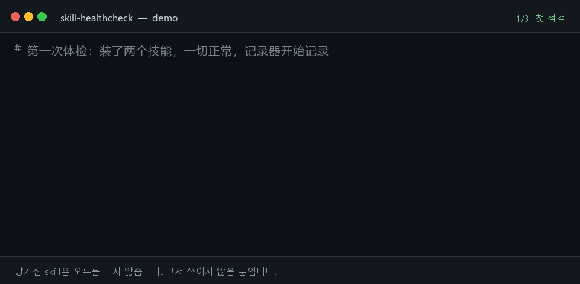

# skill-healthcheck

[English](README.md) | [中文](README.zh.md) | [日本語](README.ja.md) | 한국어 | [Español](README.es.md) | [Français](README.fr.md) | [Deutsch](README.de.md) | [Português](README.pt-BR.md)

<p align="center">
  <a href="https://github.com/lijiaqimun-coder/skill-healthcheck/actions/workflows/ci.yml"></a>
  
  
  
  
</p>

<p align="center">
  
</p>

<p align="center">
  
</p>

> 요즘 에이전트가 갑자기 멍청해졌나요? 3주 전에 설치한 그 skill이 원인일 수 있습니다.

플러그인이 고장 나면 바로 알 수 있습니다. 설치가 안 되고, 오류가 나고, UI에서 사라집니다. **하지만 skill이 고장 나면 알 수 없습니다**. `SKILL.md`는 디스크에 그대로 있고 겉보기에는 멀쩡한데, 모델이 더 이상 그것을 쓰지 않습니다. 업스트림이 `description`을 바꿨거나, skill 이름을 바꿨거나, 저장소를 지웠을 수 있습니다. 같은 이름의 로컬 skill이 그 위를 덮고 있을 수도 있습니다. 당신이 느끼는 것은 "요즘 에이전트가 말을 안 듣는다", "중국어로 답하지 않는다" 정도이고, 의심은 모델과 프롬프트로 향합니다.

`skill-healthcheck`는 한 가지 질문에만 답합니다.

**내가 설치한 것이 지금도 쓸모가 있나? 쓸모없어진 것은 어느 것이고, 언제부터인가?**

명령 하나, 점검 한 번, 출력 한 화면. 읽기 전용이며 스스로 업데이트하지 않습니다.

```text
$ skill-healthcheck
skill-healthcheck · DeepSeek Harness · profile desktop · 2026-10-23 11:57
宿主  dsh 0.2.1-rc.2 ✓
插件  0：0 正常 · 0 可升级 · 0 失效  另有组合包 1 个
技能  2：1 正常 · 1 有更新 · 0 失效
      ↑ zh-writer        上游改了 description：删去 "中文" "写作" "助手"，新增 "professional" "assistant" "marketing"  ⚠最高危
结论：技能 1 个需你逐个确认

$ skill-healthcheck why "为什么它现在不用中文回答我了"
why "为什么它现在不用中文回答我了" → 回复语言变了
现象起点：助手回复的中文占比：2026-10-19 之前约 100%，当天 0%（你仍在用中文提问）
1. doc-writer           2026-10-19 起模型看到的 description 变了
     新增"professional tone"
     新增"Always respond in English"
     删去 "需求" "整理" "结构" "清晰"
这是按时间和关键词排的嫌疑顺序，不是定论；可以先停用第 1 名验证。
```

(도구의 출력은 현재 중국어입니다. 영어 출력은 로드맵에 있습니다.)

(위 출력은 실제 `npm run demo` 결과입니다. 두 skill은 로컬 git 저장소에서 왔고, 세션 로그는 합성 데이터입니다.)

## 설치

Node.js 22.19 이상과 git이 필요합니다.

```bash
npm install -g skill-healthcheck
```

아직 npm에 공개되지 않았다면 소스에서 설치합니다.

```bash
git clone <this repo> && cd skill-healthcheck && npm install && npm run build && npm link
```

## 사용법

| 명령                                      | 하는 일                                                                                                                    |
| ----------------------------------------- | -------------------------------------------------------------------------------------------------------------------------- |
| `skill-healthcheck`                       | 한 화면 점검: 호스트, 플러그인, skill                                                                                      |
| `skill-healthcheck why "<증상>"`          | 증상에서 시간축을 거슬러 올라가 의심스러운 skill을 찾습니다. 예: `why "不用中文回答了"`. `--since 2026-10-01`도 지원합니다 |
| `skill-healthcheck log`                   | 무엇을 설치했고 무엇이 바뀌었는지, 언제인지 기록 (`~`는 파일 시각으로 추정한 값)                                           |
| `skill-healthcheck ls`                    | 플랫폼이 실제로 불러오는 skill, 가려진 것, 버려진 것                                                                       |
| `skill-healthcheck adopt <name> <source>` | skill 출처 등록: `github:owner/repo/path`, GitHub URL, `<git-url>#<path>`                                                  |
| `skill-healthcheck record`                | 스냅샷을 한 번만 기록 (훅·스케줄 작업용)                                                                                   |

공통 옵션: `--all` 전체 펼치기, `--json` 기계 판독용, `--offline` 네트워크 차단, `--no-sessions` 세션 로그 무시, `--platform dsh|generic`, `--profile <이름>`, `--cwd <프로젝트 디렉터리>`.

`check`는 문제를 찾으면 종료 코드 1을 반환하므로 CI에 넣을 수 있습니다.

## 무엇을 검사하나

**skill: 로컬(오프라인, 결정적)**

| 문제                                                                            | 왜 조용히 실패하나                                                                              |
| ------------------------------------------------------------------------------- | ----------------------------------------------------------------------------------------------- |
| frontmatter가 잘못됨 (name이 kebab-case가 아님, 불리언 오타, 옛 필드 이름 사용) | dsh가 skill 전체를 버리고 경고 한 줄만 로그에 남깁니다                                          |
| 같은 이름 skill에 가려짐                                                        | 프로젝트 쪽 `.dsh/skills`의 동명 skill이 전역에 설치한 skill을 덮습니다                         |
| 너무 깊게 중첩됨                                                                | `<root>/<name>/SKILL.md`만 인식합니다. skill 저장소를 통째로 clone하면 하나도 적용되지 않습니다 |
| 잘못된 디렉터리                                                                 | dsh는 `~/.claude/skills`나 `~/.codex/skills`를 스캔하지 않습니다                                |
| description이 500자를 넘음                                                      | 카탈로그에서 잘려 끝부분의 트리거 단어가 모델에 닿지 않습니다                                   |
| 예전에는 자주 호출되다가 어느 날부터 호출되지 않음                              | 세션 로그의 증거가 어떤 추론보다 강합니다                                                       |

**skill: 업스트림(git, 모든 호스팅)**

| 업스트림 변화                       | 영향                                                                                                                      |
| ----------------------------------- | ------------------------------------------------------------------------------------------------------------------------- |
| `description` 변경                  | ⚠ 가장 위험: 트리거 조건이 바뀌어 다시는 호출되지 않을 수 있습니다. 삭제·추가된 단어를 나열하고 언어·톤 규칙을 표시합니다 |
| `name` 변경 / 디렉터리 이동         | `/옛이름` 진입점이 동작하지 않습니다. 새 진입점을 알려줍니다                                                              |
| 저장소 삭제 / skill 삭제            | 로컬 사본은 더 이상 관리되지 않습니다 (명확한 404만 삭제로 판정하고, 네트워크 실패는 "확인할 수 없음"으로 보고)           |
| `scripts/`에 실행 파일 추가         | 사람이 코드를 검토해야 합니다                                                                                             |
| description이 길어짐 또는 상한 초과 | 잘리거나, 매번 컨텍스트를 더 차지합니다                                                                                   |
| 본문이 길어짐                       | 호출마다 추가로 쓰는 token 수 (본문은 필요할 때 로드하므로 다른 skill을 밀어내지 않습니다)                                |
| 플랫폼 전용 문법 추가               | PowerShell cmdlet, `brew`, `/usr/bin` 등. 당신의 시스템에서는 실행되지 않을 수 있습니다                                   |

**플러그인(dsh)**: profile에 설치된 플러그인이 현재 dsh와 호환되는지(`engines.dsh` / peerDependencies), 버전 예외로 돌고 있지는 않은지, npm에 새 버전이 있는지, 작성자가 폐기했는지.

**결론 줄은 일부러 비대칭입니다**: `插件 2 个可一键升级；技能 3 个需你逐个确认`(플러그인 2개는 한 번에 업그레이드, skill 3개는 하나씩 확인 필요). 플러그인은 npm 패키지라 버전이 있고 되돌릴 수 있습니다. skill은 프롬프트라서 덮어쓰면 원본이 사라지고, 동작이 바뀌어도 알 수 없습니다. 그래서 사람이 봐야 합니다.

## 원인 추적: `why`

도구는 첫 실행부터 기록합니다(`~/.skill-healthcheck/journal.jsonl`). 무엇을 설치했고 무엇이 바뀌었고 무엇이 삭제되었는지, 그리고 모든 버전의 `SKILL.md` 전문을 저장합니다. `why`는 이 기록과 dsh 자체의 세션 로그(모델이 매번 본 skill 카탈로그가 시간순으로 들어 있음)를 결합해 의심 항목의 순위를 매깁니다.

- **증상 사전**: "중국어로 답하지 않는다"를 언어 관련 규칙(`respond in English`, `professional tone`, `默认使用英文` 등)에 대응시킵니다
- **시간**: 증상 시작점에 가까운 변경일수록 의심스럽고, 증상 이후의 변경은 가중치를 낮춥니다
- **행동 변화점**: 세션 로그에서 중국어 응답 비율과 skill 호출 횟수를 계산해 변화가 시작된 날을 찾습니다

전부 결정적 코드이고 LLM을 호출하지 않으므로 결과가 안정적이며 테스트할 수 있습니다.

## 실제 데이터로 검증

공개 skill 저장소 15곳(anthropics/skills, obra/superpowers, vercel-labs/agent-skills, deepseek-ai/deepseek-harness 등)에서 실제 `SKILL.md` 변경 74건을 모아 규칙으로 하나씩 판정했습니다.

| 변경 유형        | 보고 / 실제 |
| ---------------- | ----------: |
| description 변경 |     44 / 44 |
| name 변경        |     18 / 18 |
| 디렉터리 이동    |     20 / 20 |
| 스크립트 추가    |     13 / 13 |

이 데이터에서 업스트림 변경 37건이 description에 있던 단어를 지웠고, 16건이 name을 바꿨으며, 3건은 새 버전이 dsh에서 그대로 버려집니다. 데이터셋, 재현 방법, 규칙 조정은 [research/EVAL.md](research/EVAL.md)에 있습니다.

## 데이터와 프라이버시

- skill 디렉터리, dsh profile, 세션 로그만 읽습니다. `~/.skill-healthcheck/` 밖에는 아무 파일도 쓰지 않습니다.
- 세션 로그는 로컬에서만 읽고, 캐시하는 것은 파생 데이터(skill 카탈로그, 호출 횟수, 일별 중국어 응답 비율)뿐입니다. 대화 원문은 저장하지 않습니다.
- 업스트림 검사는 `~/.skill-healthcheck/cache/`의 별도 bare 저장소에서 수행하며, 당신의 skill 저장소를 fetch하거나 수정하지 않습니다.
- 네트워크는 세 가지만 씁니다: skill 업스트림 `git fetch`, 저장소 존재 확인용 GitHub API, 플러그인 버전 확인용 `npm view`. `--offline`이면 전부 꺼집니다.

## 플랫폼 지원

| 플랫폼                                   | 지원 범위                                                                                         |
| ---------------------------------------- | ------------------------------------------------------------------------------------------------- |
| DeepSeek Harness(dsh)                    | 전체: dsh의 스캔 순서와 파싱 규칙을 그대로 따르고, 세션 로그를 채우며, 플러그인과 호스트까지 검사 |
| 일반 Agent Skills(Claude Code, Codex 등) | `.agents/skills`, `.claude/skills`, `~/.codex/skills`를 스캔해 로컬·업스트림 검사 수행            |

`~/.dsh/profiles`가 감지되면 자동으로 dsh 모드가 됩니다. `--platform`으로 지정할 수도 있습니다.

## skill 출처를 정하는 방법

dsh 자체는 skill을 어디서 설치했는지 기록하지 않습니다. 그래서 다음 순서로 찾고, 없으면 추측하지 않고 "출처 알 수 없음"이라고 답합니다.

1. `skill-healthcheck adopt`로 등록한 출처
2. frontmatter의 `metadata.source`
3. skill 디렉터리가 git checkout이면 그 `origin`

## 개발

```bash
npm install
npm test        # vitest: parsing, discovery, journal, impact rules, upstream (local bare repos), attribution, lexicon
npm run demo    # 15-second demo, runs entirely inside demo/.sandbox
node scripts/corpus-eval.mjs   # run the impact rules over 74 real changes (build first; fetches files from GitHub)
```

## 로드맵

- [x] 기록, 로컬 조용한 실패 검사, 세션 로그 채우기
- [x] 업스트림 생존 확인과 변경 영향 평가
- [x] `why` 원인 추적(최소 버전)
- [x] 플러그인 호환성과 업그레이드 가능 여부 검사(dsh)
- [ ] dsh 플러그인 셸 `dsh-skill-healthcheck`: 호스트 시작 시 기록, skill 변경 감시, `/skill-healthcheck` 제공
- [ ] 선택적 `--explain`: LLM으로 diff를 한 문장으로 요약(기본 비활성)
- [ ] 영어 출력 (`--lang en`)

## License

MIT
