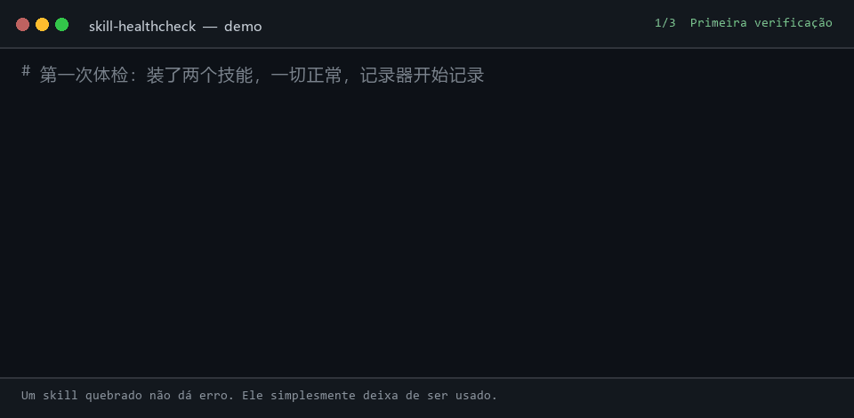

# skill-healthcheck

[English](README.md) | [中文](README.zh.md) | [日本語](README.ja.md) | [한국어](README.ko.md) | [Español](README.es.md) | [Français](README.fr.md) | [Deutsch](README.de.md) | Português

<p align="center">
  <a href="https://github.com/lijiaqimun-coder/skill-healthcheck/actions/workflows/ci.yml"></a>
  
  
  
  
</p>

<p align="center">
  
</p>

<p align="center">
  
</p>

> Seu agente ficou mais burro ultimamente? Pode ser aquele skill que você instalou três semanas atrás.

Quando um plugin quebra, você percebe na hora: não instala, dá erro, some da interface. **Quando um skill quebra, você nunca fica sabendo**: o `SKILL.md` continua no disco, tudo parece normal, e o modelo simplesmente para de usá-lo. Talvez o upstream tenha mudado a `description`, renomeado o skill, apagado o repositório — ou um skill local com o mesmo nome esteja cobrindo o seu. Você só nota que "o agente parou de obedecer" ou que "ele não responde mais em chinês", e acaba culpando o modelo e os seus prompts.

O `skill-healthcheck` responde a uma única pergunta:

**O que eu instalei ainda funciona? O que quebrou, e desde quando?**

Um comando, uma verificação, uma tela de saída. Somente leitura, e nunca se atualiza sozinho.

```text
$ skill-healthcheck
skill-healthcheck · DeepSeek Harness · profile desktop · 2026-10-23 11:57
宿主  dsh 0.2.1-rc.2 ✓
插件  0：0 正常 · 0 可升级 · 0 失效  另有组合包 1 个
技能  2：1 正常 · 1 有更新 · 0 失效
      ↑ zh-writer        上游改了 description：删去 "中文" "写作" "助手"，新增 "professional" "assistant" "marketing"  ⚠最高危
结论：技能 1 个需你逐个确认

$ skill-healthcheck why "为什么它现在不用中文回答我了"
why "为什么它现在不用中文回答我了" → 回复语言变了
现象起点：助手回复的中文占比：2026-10-19 之前约 100%，当天 0%（你仍在用中文提问）
1. doc-writer           2026-10-19 起模型看到的 description 变了
     新增"professional tone"
     新增"Always respond in English"
     删去 "需求" "整理" "结构" "清晰"
这是按时间和关键词排的嫌疑顺序，不是定论；可以先停用第 1 名验证。
```

(A saída da ferramenta está atualmente em chinês; a saída em inglês está no roteiro.)

(A saída acima vem de uma execução real de `npm run demo`: os dois skills vêm de repositórios git locais e o log de sessão é sintético.)

## Instalação

Requer Node.js 22.19+ e git.

```bash
npm install -g skill-healthcheck
```

Se ainda não estiver no npm, instale a partir do código-fonte:

```bash
git clone <this repo> && cd skill-healthcheck && npm install && npm run build && npm link
```

## Uso

| Comando                                   | O que faz                                                                                                               |
| ----------------------------------------- | ----------------------------------------------------------------------------------------------------------------------- |
| `skill-healthcheck`                       | Verificação em uma tela: host, plugins, skills                                                                          |
| `skill-healthcheck why "<sintoma>"`       | Volta na linha do tempo até os skills suspeitos, por exemplo `why "不用中文回答了"`; também aceita `--since 2026-10-01` |
| `skill-healthcheck log`                   | Registro do que foi instalado, do que mudou e quando (`~` indica horários estimados pela data dos arquivos)             |
| `skill-healthcheck ls`                    | Quais skills a plataforma realmente carrega, quais estão cobertos e quais são descartados                               |
| `skill-healthcheck adopt <name> <origem>` | Registra a origem de um skill: `github:owner/repo/path`, uma URL do GitHub ou `<git-url>#<path>`                        |
| `skill-healthcheck record`                | Registra um único snapshot (para hooks e tarefas agendadas)                                                             |

Opções comuns: `--all` expandir tudo, `--json` legível por máquina, `--offline` sem rede, `--no-sessions` ignorar os logs de sessão, `--platform dsh|generic`, `--profile <nome>`, `--cwd <diretório do projeto>`.

O `check` retorna código de saída 1 quando encontra problemas, então serve para CI.

## O que ele verifica

**Skills: local (offline, determinístico)**

| Problema                                                                                      | Por que falha em silêncio                                                                                     |
| --------------------------------------------------------------------------------------------- | ------------------------------------------------------------------------------------------------------------- |
| frontmatter inválido (name fora do kebab-case, booleano escrito errado, nome de campo antigo) | O dsh descarta o skill inteiro e só registra uma linha de aviso no log                                        |
| Coberto por um skill de mesmo nome                                                            | Um skill de mesmo nome em `.dsh/skills` do projeto cobre o que você instalou globalmente                      |
| Aninhamento profundo demais                                                                   | Só `<root>/<name>/SKILL.md` é reconhecido; clone um repositório inteiro de skills ali e nenhum entra em vigor |
| Diretório errado                                                                              | O dsh não varre `~/.claude/skills` nem `~/.codex/skills`                                                      |
| description com mais de 500 caracteres                                                        | Ela é truncada no catálogo, então o modelo nunca vê as palavras de ativação do final                          |
| Antes era muito invocado e um dia deixou de ser                                               | A evidência do log de sessão vale mais do que qualquer dedução                                                |

**Skills: upstream (git, qualquer plataforma de hospedagem)**

| Mudança no upstream                         | Impacto                                                                                                                                                                |
| ------------------------------------------- | ---------------------------------------------------------------------------------------------------------------------------------------------------------------------- |
| `description` alterada                      | ⚠ Risco máximo: as condições de ativação mudaram e o skill pode nunca mais ser invocado. Ele lista as palavras removidas e adicionadas e sinaliza regras de idioma/tom |
| `name` alterado / diretório movido          | O ponto de entrada `/nome-antigo` para de funcionar; ele informa o novo                                                                                                |
| Repositório apagado / skill apagado         | Sua cópia local fica sem manutenção (apenas um 404 explícito conta como exclusão; falhas de rede são reportadas como "não foi possível verificar")                     |
| Novo executável em `scripts/`               | Uma pessoa precisa revisar o código                                                                                                                                    |
| description ficou maior ou passou do limite | Ela é truncada, ou ocupa mais contexto a cada turno                                                                                                                    |
| Corpo ficou maior                           | Quantos tokens extras cada invocação custa (o corpo é carregado sob demanda, então não desloca outros skills)                                                          |
| Nova sintaxe específica de plataforma       | Cmdlets do PowerShell, `brew`, `/usr/bin`, por exemplo — pode não rodar no seu sistema                                                                                 |

**Plugins (dsh)**: se os plugins instalados em um profile são compatíveis com a versão atual do dsh (`engines.dsh` / peerDependencies), se rodam graças a uma isenção de versão, se o npm tem uma versão mais nova e se o autor os marcou como obsoletos.

**A linha de conclusão é assimétrica de propósito**: `插件 2 个可一键升级；技能 3 个需你逐个确认` ("2 plugins podem ser atualizados de uma vez; 3 skills precisam ser revisados um a um"). Plugins são pacotes npm com número de versão e rollback; skills são prompts — uma vez sobrescrito, a versão antiga se foi, e se o comportamento mudou você não saberia. Por isso uma pessoa precisa olhar.

## Atribuição: `why`

A ferramenta começa a registrar desde a primeira execução (`~/.skill-healthcheck/journal.jsonl`): o que foi instalado, o que mudou, o que foi apagado, com o texto completo de cada versão de cada `SKILL.md`. O `why` combina esse diário com os logs de sessão do próprio dsh (que contêm, em ordem, o catálogo de skills que o modelo viu a cada vez) para ordenar os suspeitos:

- **Léxico de sintomas**: mapeia "parou de responder em chinês" para regras de idioma (`respond in English`, `professional tone`, `默认使用英文`, …)
- **Tempo**: mudanças mais próximas do início do sintoma são mais suspeitas; as que vieram depois perdem peso
- **Ponto de mudança de comportamento**: calcula a proporção de respostas em chinês e o número de invocações a partir dos logs de sessão para achar o dia em que a mudança começou

Tudo é código determinístico, sem chamadas a LLM, então os resultados são estáveis e testáveis.

## Validado com dados reais

Reunimos 74 mudanças reais de `SKILL.md` em 15 repositórios públicos de skills (anthropics/skills, obra/superpowers, vercel-labs/agent-skills, deepseek-ai/deepseek-harness, entre outros) e aplicamos as regras a cada uma:

| Tipo de mudança      | Detectadas / reais |
| -------------------- | -----------------: |
| description alterada |            44 / 44 |
| name alterado        |            18 / 18 |
| diretório movido     |            20 / 20 |
| scripts adicionados  |            13 / 13 |

Neste conjunto, 37 mudanças no upstream removeram palavras que estavam na description, 16 renomearam o skill e 3 geraram uma versão que o dsh descarta de imediato. O conjunto de dados, os passos de reprodução e o ajuste das regras estão em [research/EVAL.md](research/EVAL.md).

## Dados e privacidade

- Lê apenas seus diretórios de skills, os profiles do dsh e os logs de sessão; não escreve nada fora de `~/.skill-healthcheck/`.
- Os logs de sessão são lidos somente no local, e apenas dados derivados são cacheados (catálogo de skills, número de invocações, proporção diária de respostas em chinês). O texto das conversas nunca é armazenado.
- As verificações de upstream rodam em repositórios bare separados em `~/.skill-healthcheck/cache/`; ele nunca faz fetch nem modifica os seus próprios repositórios de skills.
- O acesso à rede faz exatamente três coisas: `git fetch` dos upstreams de skills, consultar a API do GitHub para saber se um repositório ainda existe e `npm view` para versões de plugins. O `--offline` desliga tudo.

## Plataformas suportadas

| Plataforma                                       | Nível de suporte                                                                                                            |
| ------------------------------------------------ | --------------------------------------------------------------------------------------------------------------------------- |
| DeepSeek Harness (dsh)                           | Completo: reproduz a ordem de varredura e as regras de parsing do dsh, preenche os logs de sessão e verifica plugins e host |
| Agent Skills genéricos (Claude Code, Codex etc.) | Varre `.agents/skills`, `.claude/skills`, `~/.codex/skills` e executa verificações locais e de upstream                     |

Ele entra no modo dsh automaticamente quando detecta `~/.dsh/profiles`; você também pode forçar com `--platform`.

## Como a origem de um skill é determinada

O próprio dsh não registra de onde o skill foi instalado, então a ferramenta tenta nesta ordem e, se não achar, diz "origem desconhecida" em vez de adivinhar:

1. Uma origem registrada com `skill-healthcheck adopt`
2. `metadata.source` no frontmatter
3. O diretório do skill é um checkout git → usar o `origin` dele

## Desenvolvimento

```bash
npm install
npm test        # vitest: parsing, discovery, journal, impact rules, upstream (local bare repos), attribution, lexicon
npm run demo    # 15-second demo, runs entirely inside demo/.sandbox
node scripts/corpus-eval.mjs   # run the impact rules over 74 real changes (build first; fetches files from GitHub)
```

## Roteiro

- [x] Diário, verificação local de falhas silenciosas, preenchimento dos logs de sessão
- [x] Verificação de disponibilidade do upstream e avaliação do impacto das mudanças
- [x] Atribuição com `why` (versão mínima)
- [x] Compatibilidade de plugins e verificação de atualizações (dsh)
- [ ] Shell de plugin do dsh `dsh-skill-healthcheck`: registrar na inicialização do host, observar mudanças de skills, expor `/skill-healthcheck`
- [ ] `--explain` opcional: usar um LLM para transformar o diff em uma frase clara (desligado por padrão)
- [ ] Saída em inglês (`--lang en`)

## License

MIT
